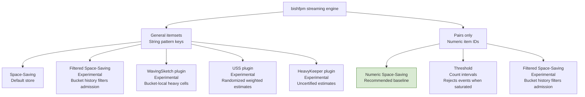

# bishfpm

Boundary-Independent Streaming Heuristic Frequent Pattern Mining.

A compact C library for finding recurring combinations of attributes in event streams.
It tracks each group independently, gives recent events more weight, and calls
your code when a combination meets configured count and share thresholds.
Memory and per-event work have explicit budgets.

Counts are approximate. Your application decides what a frequent pattern means
and whether it warrants action.

## Applications

The frequent-pattern techniques used here have been applied to fraud
detection [1], anomaly isolation [2], and DDoS protection. For example, Cloudflare
describes generating fingerprint combinations from sampled traffic, using a
streaming algorithm to select those with the most matches, and activating
mitigation when thresholds are exceeded [3]. The common idea is to uncover
recurring combinations of attributes that reveal meaningful patterns despite
variation in individual events.

## References

1. Seeja, K. R., and Zareapoor, M. (2014). “[FraudMiner: A Novel Credit Card Fraud Detection Model Based on Frequent Itemset Mining](https://pmc.ncbi.nlm.nih.gov/articles/PMC4180893/).” *The Scientific World Journal*.
2. “[Automating Root-Cause Analysis of Network Anomalies using Frequent Itemset Mining](https://conferences.sigcomm.org/sigcomm/2010/papers/sigcomm/p467.pdf).” *ACM SIGCOMM*, 2010.
3. Yoachimik, O. (2025). “[Defending the Internet: how Cloudflare blocked a monumental 7.3 Tbps DDoS attack](https://blog.cloudflare.com/defending-the-internet-how-cloudflare-blocked-a-monumental-7-3-tbps-ddos/).” *Cloudflare Blog*.

## Quick start

Build on Linux with GCC or Clang and GNU make:

```sh
make -j2 libraries
```

Save this as `example.c`. Repeated events let the patterns reach the default
alert thresholds; timestamps are in milliseconds.

```c
#include <stdio.h>
#include "bishfpm.h"

static void alert(const char *group, const bishfpm_trigger_t *t, void *unused) {
    (void)unused;
    printf("%s: %s, count %.2f, share %.3f\n",
           group, t->formatted, t->pattern_rate, t->rate_fraction);
}

int main(void) {
    bishfpm_config_t cfg;
    bishfpm_config_default(&cfg);
    bishfpm_t *engine = bishfpm_create(&cfg);
    if (!engine) return 1;

    const char *items[] = {"user=alice", "country=US", "device=mobile"};
    for (uint64_t t = 1000; t < 1012; t++) {
        if (bishfpm_add_event(engine, "store_101", t, items, 3, alert, NULL) < 0) {
            bishfpm_free(engine);
            return 1;
        }
    }
    bishfpm_free(engine);
    return 0;
}
```

```sh
cc -std=c11 -Iinclude example.c ./libbishfpm.a -lm -o example
./example
```

This emits four alerts: three pairs and one triple. Their counts are about 6,
because the item gate excludes the earlier events from pattern history.

Ingestion returns `-1` if the event is rejected, otherwise the number of alert
decisions. Rejected events can be retried. Callbacks run synchronously; copy any
results you want to retain and serialize access to each engine.

## Configuration

Start with `bishfpm_config_default`, then adjust what your workload needs:

| Setting | Default | Controls |
| --- | --- | --- |
| `ewma_half_life_ms` | 5000 | How quickly old events lose weight |
| `min_itemset_order` / `max_itemset_order` | 2 / 3 | Sizes of combinations to track |
| `item_rate_threshold` | 5 | Minimum item count before considering its combinations |
| `min_pattern_rate` | 5 | Minimum pattern count for an alert |
| `promotion_fraction` | 0.20 | Minimum pattern share within its group |
| `trigger_cooldown_ms` | 10000 | Minimum time between alerts for the same pattern |
| `max_memory_bytes` | 256 MiB | Library allocation budget |

Counts decay over time; they are not events per second. Item gates omit earlier
pattern history. Input and candidate limits reject oversized events whole.
When `min_pattern_rate` is positive, `item_rate_threshold` must not exceed it;
for example, lowering `min_pattern_rate` to 1 also requires lowering the default
item threshold to 1 or less. Constructors return `NULL` for invalid settings,
an initial payload requirement above `max_memory_bytes`, or allocation failure.
The default conservative memory mode also requires the configured worst-case
payload bound to fit that budget. Opt-in dynamic mode checks allocations as the
engine grows instead; required reservation denial rejects an event before counts
change.
See the configuration fields in `bishfpm.h` and
resource limits in `docs/DESIGN.md` for details.

## Choosing a store

Precision, recall, memory use and throughput depend on the store, its
configuration and the workload. Several stores are available so applications can
choose suitable accuracy and resource tradeoffs. Additional backends integrate
through the optional descriptor API without changing mining policy.

The experimental HeavyKeeper plugin retains frequent candidates with probabilistic
collision handling and wall-clock decay. Selecting its descriptor explicitly opts
into heuristic alerts: estimates are uncertified, and bounds queries report
`known=0` with `[0,+infinity]`. See `examples/heavykeeper.c`.

The experimental USS plugin uses randomized weighted Space Saving with EWMA
decay. It returns zero for nonresident keys and retains positive sampled counters
during pruning. Selecting it opts into heuristic alerts and unknown bounds.
Alerts use matching updates since admission, while queries retain the sampled
estimate. See `examples/uss.c`.

The experimental WavingSketch plugin uses bucket-local heavy cells and signed
counters, with weighted EWMA updates and heuristic estimates. Alerts require
matching-update evidence since admission; collision history remains available for
discovery. See `examples/wavingsketch.c`.



| Store | Use it for |
| --- | --- |
| `bishfpm_create` | General combinations, including higher-order itemsets |
| `BISHFPM_STORE_FSS` via `bishfpm_create_with_options` | Experimental filtering for general combinations, including higher-order itemsets |
| `BISHFPM_PAIR_SS` | Pair-only streaming; the recommended starting point |
| `BISHFPM_PAIR_THRESHOLD` | Explicit forgetting bounds and rejection when capacity is exhausted |
| `BISHFPM_PAIR_FSS` | Experimental filtering under candidate pressure |
| `bishfpm_heavykeeper_store` via `bishfpm_create_with_store` | Experimental text HeavyKeeper; explicitly heuristic alerts and estimates |
| `bishfpm_uss_store` via `bishfpm_create_with_store` | Experimental weighted Unbiased Space Saving; explicitly heuristic alerts and estimates |
| `bishfpm_wavingsketch_store` via `bishfpm_create_with_store` | Experimental weighted EWMA WavingSketch; explicitly heuristic alerts and estimates |
| `bishfpm_pair_counter_new` | Exact counts over a fixed vocabulary, without decay or alerts |

General stores use `topk_k` for resident pattern capacity. With
`bishfpm_create_with_options`, select `BISHFPM_STORE_SS` with zero `sketch_width`
or `BISHFPM_STORE_FSS` with `sketch_width` from 1 through `2^24`. See
[Experimental general-store FSS and memory options](docs/DESIGN.md#experimental-general-store-fss-and-memory-options)
for an example.

Numeric stores use `bishfpm_create_pairs` with both itemset orders set to 2.
Their pair capacity is separate from `topk_k`, which sizes cooldown storage.
Numeric dictionaries retain item identities until their group is removed.

| Numeric store | Additional configuration requirements |
| --- | --- |
| `BISHFPM_PAIR_SS` | `sketch_width = 0` |
| `BISHFPM_PAIR_THRESHOLD` | `sketch_width = 0`, `item_rate_threshold = 0`, and `item_share_threshold = 0` |
| `BISHFPM_PAIR_FSS` | `sketch_width` from 1 through `2^24`; bounds cover evaluated candidates, with full transaction history only when both marginal gates are `0` |

All numeric stores require positive `capacity` and finite, nonnegative
`forget_below`. For example, use this configuration and constructor in the
quick start for a threshold pair engine:

```c
bishfpm_config_t cfg;
bishfpm_config_default(&cfg);
cfg.min_itemset_order = cfg.max_itemset_order = 2;
cfg.item_rate_threshold = cfg.item_share_threshold = 0;
bishfpm_pair_options_t options = {
    .store = BISHFPM_PAIR_THRESHOLD,
    .capacity = 1024,
    .sketch_width = 0,
    .forget_below = 0.5,
};
bishfpm_t *engine = bishfpm_create_pairs(&cfg, &options);
if (!engine) return 1;
```

## Build and check

```sh
make -j2 all         # Libraries, examples, tests, and benchmarks
make ci             # Regression tests and installed C/C++ consumer checks
make sanitize       # Address and undefined-behavior checks with Clang
make clean          # Remove sanitizer-instrumented objects and libraries
make -j2 all        # Restore a normal build before benchmarks or installation
make fuzz-smoke     # Bounded fuzz run with Clang
make bench          # Microbenchmarks and counter-store quality
make install PREFIX=/usr/local
```

Tests require Perl's `prove`. `make ci` also requires a C++ compiler,
`pkg-config`, and binutils (`nm` and `readelf`). Sanitizer and fuzz targets
require Clang with the corresponding sanitizer runtimes. `make sanitize`
reuses the normal object and archive paths, so clean and rebuild afterward as
shown above before using normal build targets.

`examples/stream_tsv` reads timestamp (seconds), group, and 1–32 item columns.
Sample streams are in `data/`.
Run `./examples/stream_tsv data/sample_storefronts.tsv` to see one
hour of five storefronts sharing an engine. Each storefront normally receives
one event per second; short bursts add ten per second. The lower thresholds
selected by the file's profile header expose patterns in those bursts. The
florist and toy storefronts have bursts; fashion, pantry, and books retain
steady co-occurrences without alerts. The burst alerts include pair, triple,
and four-attribute patterns: red-tulip orders to Denmark in two waves and
Labubu doll orders to Korea.
The example schedules pruning only after accepted records, so rejected timestamps
cannot expire valid history. Applications that need to reclaim capacity while
ingestion is blocked must schedule maintenance independently before retrying.

## Validation

Development testing has used two public datasets:

- [Kosarak](https://cs.rpi.edu/~zaki/Workshops/FIMI/data/), anonymized clickstream
  transactions, to exercise varied basket widths and pair-count recovery.
- [LANL authentication events](https://lanl.ma.ic.ac.uk/data/cyber1/), from the
  Comprehensive, Multi-Source Cyber-Security Events dataset, to exercise temporal
  behavior, group and vocabulary growth, and retention and notification policies.

The bundled `make ci` checks use synthetic streams, including reference counts
for checking count bounds and controlled cases for emerging patterns, late
input, pruning, and rejection. `make bench` includes a counter-store comparison
against exact reference counts, reporting threshold precision/recall and top-k
overlap. Dataset replay harnesses and the datasets themselves are not included
in this release.

Count recovery and notification delivery are separate measures. These checks
do not establish fraud or anomaly detection accuracy.

## Custom pattern stores

`bishfpm_store_plugin.h` provides an opt-in, versioned descriptor API through
`bishfpm_create_with_store`. A backend can use canonical text itemsets or packed
numeric pairs, typed owned configuration, whole-event reservation, certified
bounds, and host-budgeted allocation. Existing constructors retain direct built-in
updates. See `docs/STORE_PLUGINS.md` and `examples/store_plugin.c`.

## Further reading

- `docs/DESIGN.md`: time, counts, callbacks, limits, and experimental options.
- `docs/STORE_PLUGINS.md`: writing a custom pattern store plugin.
- `docs/PRIOR_ART.md`: inherited techniques and comparison scope.
- `bishfpm_lowlevel.h`: counters, stores, rates, and arenas.

MIT licensed; see `LICENSE`.
