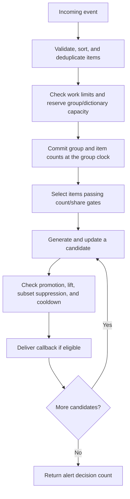

# Design and operating contract

Bishfpm tracks recurring combinations of categorical attributes within groups.
Each group has its own decayed counts, candidate store, and notification state.
The engine turns incoming events into count updates and synchronous alerts;
the application chooses the groups, thresholds, and meaning of those alerts.

## Event processing



Preparation checks the complete event before committing counts. It validates
encoded lengths, bounds candidate work, and reserves all missing dictionary
keys. Stores that require capacity reservation also check whether the complete
event can fit. Failure at this stage rejects the whole event.

After reservation, the engine updates the group count and every distinct item's
count. Items passing the marginal count/share gates participate in candidate
generation. The general engine enumerates configured itemset orders from smallest
to largest; numeric engines enumerate pairs directly.

Each candidate update and its notification finish before the next candidate is
updated. A callback querying the engine sees that intermediate state. Processing
all candidates first and delivering callbacks afterward would change this contract.

## Counts and time

All count thresholds and query results use exponentially decayed counts. With
half-life `H` and `lambda = ln(2) / H`, event weights `w_i` at times `t_i`
contribute to the count at time `T`:

```text
decay(dt) = exp(-lambda * dt) = 2^(-dt / H)
C(T)      = sum_i(w_i * decay(T - t_i))
```

Times and half-life are in milliseconds. After one half-life, a contribution of
10 becomes 5. Exponential decay permits an incremental update without retaining
the events: advance the previous count by multiplying by `decay(dt)`, then add
the new weight. Decay factors compose:

```text
decay(a + b) = decay(a) * decay(b)
```

Advancing in several steps therefore gives the same count as advancing once,
up to floating-point rounding. At a common time, aging multiplies counts and
their error bounds by the same positive factor, preserving inequalities and
count ratios until new input or pruning changes them.

### Relating counts to arrival rates

Counts measure weighted arrival history. The exponential kernel has total mass
`1 / lambda` milliseconds, so `C(T) * 1000 * lambda` gives a normalized smoothed
per-second rate estimate.

For an unfiltered counter receiving stationary Poisson arrivals at `r` events
per second, with unit weights, the steady-state moments at an arbitrary
observation time are:

```text
E[C]   = r * H / (1000 * ln(2))
Var[C] = r * H / (2000 * ln(2))
```

A longer half-life accumulates more mass and responds more slowly to changes.
For example, 10 events/second with a 1,000 ms half-life gives an expected count
of about 14.43. This calibrates thresholds; an individual observation fluctuates.

Periodic arrivals have a different shape. With one unit event every `d`
milliseconds, the steady-state count immediately after an arrival is
`1 / (1 - exp(-lambda * d))`. Substituting the mean Poisson spacing into that
formula does not give the Poisson expectation. These formulas describe the
underlying counter; gates, retention uncertainty, and pruning affect pattern
estimates.

### Watermarks and late input

Each group maintains a monotonic watermark. Accepted events and successful
maintenance advance it; queries and no-op calls do not. Timestamp zero is valid.
Late events are discounted to the watermark before updating counts or evaluating
gates and alerts. Callback timestamps use this effective group time.

Queries before the watermark clamp to it. Queries into the future decay the
current state without changing the watermark. Historical state cannot be
reconstructed by querying an old timestamp. Standalone rate counters and top-k
stores maintain their own clocks.

Engine event weights are integers through `UINT32_MAX`. Standalone floating
weight APIs require finite, nonnegative weights and a finite, positive half-life.
Double precision limits apply: unit increments may lose resolution above `2^53`,
and sufficiently old contributions underflow to zero.

## How the stages work together

The engine separates which combinations to examine, how much recent support
they have, and whether to notify the application. Each stage addresses a
different part of the problem.

### Limit discovery work before counting combinations

A candidate is a combination of distinct items from the current event, within
the configured itemset orders. An item is eligible when its updated marginal
count meets `item_rate_threshold` and, when enabled, its share of the updated
group count meets `item_share_threshold`. Every item in a candidate must qualify.
These gates include the current event's contribution.

An event with `M` distinct items has `2^M - 1` nonempty subsets. Limiting itemset
order and selecting items through marginal gates reduces the combinations sent
to the store. With `m` eligible items and pair-only tracking, this becomes
`m * (m - 1) / 2` candidate updates.

The mathematical motivation is that a combination cannot occur more often than
any of its constituent items when counted over the same history. However, the
online gate is a deliberate approximation: combinations receive no updates
before all their items qualify. Passing a gate later cannot recover that earlier
history. The work budget separately rejects an event whose worst-case expansion
is too large, even if gates might have reduced its actual expansion.

### Compare recent support within a group

Group, item, and pattern counts use the same half-life and effective time. This
makes ratios compare mass over the same aging rule. Let `G` be group count,
`I_i` item counts, and `L` a conservative pattern count. The decision quantities
are:

```text
absolute support         = L
group share              = L / G
independence expectation = G * product_i(I_i / G)
lift                     = L / independence expectation
```

Lift defaults to `1.0` for singletons or nonpositive count inputs. Positive
counts use scaled arithmetic when needed to avoid intermediate underflow;
lift above the representable double range is positive infinity. Group share is
zero when the group count is zero.

Absolute support requires enough observed mass. Group share asks whether the
pattern accounts for a substantial part of this group's activity. Lift asks
whether co-occurrence exceeds the expectation from the current item marginals.
For example, `G=1000`, `I_a=200`, `I_b=100`, and `L=50` give 5% group share and
lift 2.5: the pair is concentrated relative to independence while representing
a modest share of the group. The application chooses which conditions matter.
Lift uses the maintained marginals, including any effects of marginal pruning;
it does not establish statistical significance or a change from past behavior.

### Keep counting uncertainty separate from notification policy

The store supplies count estimates; it determines which candidates remain
available and how uncertain their counts are. Where conservative bounds are
available, promotion uses the lower bound. This prevents upper-estimate error
alone from creating support, share, or lift eligibility, but uncertainty and
missing history can still cause missed promotions. Changing the store changes
these accuracy and resource tradeoffs without changing the role of the other
stages.

Subset suppression and cooldowns then control overlapping and repeated alerts.
They do not stop candidate counting. A pattern can remain frequent while
producing no callback, and a high count-recovery rate need not imply the same
notification recall. Counting quality and notification policy must therefore
be evaluated separately.

## Input and identity

Events belong to a nonempty group key. Items are sorted and deduplicated, so
repeated attributes count once per event; NULL and empty item entries are
ignored. Input strings are borrowed for ingestion, and retained keys are copied.

Valid zero-weight or empty-input calls return zero without changing group state
or evaluating notifications. They count as `events_noop`; basic argument and
input-width validation still applies.

Patterns use sorted unique items joined by unit separators (`0x1f`), which cannot
appear inside an item. Use this canonical encoding as identity; formatted output
is for display and can be truncated or ambiguous. Hash collisions are resolved
using complete identities. Representation limits are defined in
`bishfpm_limits.h`.

### Numeric identities

Numeric pair engines assign stable per-group IDs to item strings and pack two
IDs into a pair key. Strings remain in the dictionary for input lookup and
output; public pattern queries still use canonical two-item strings.

Marginal pruning resets weak counts but keeps these identities, so the item
limit bounds lifetime vocabulary until the group is removed. Pruning a pair
neither recycles its IDs nor releases its cooldown. Group removal discards the
dictionary, patterns, and cooldowns together.

## Store interface and count uncertainty

The engine sends each evaluated candidate's identity, discounted weight, and
common group time to its store. The store returns residency and a count estimate
with any available uncertainty bounds. Its retention policy determines which
patterns remain available under the configured memory limit. See the
`README.md` (Choosing a store) for store selection and
`PRIOR_ART.md` (Ancestry) for algorithm lineage.

Bounds cover the evaluated candidate stream: only candidates whose items pass
the marginal gates receive updates. Disabling both gates includes every
combination of the configured orders in accepted events. Weighted and
unit-by-unit replay can cross gates at different times.

A known interval encloses the candidate's true decayed count for that history,
subject to floating-point rounding. Estimates and their uncertainty age together.
Where an upper estimate `U` and error `E` are available:

```text
lower = max(0, U - E)
upper = U
```

The engine uses the conservative lower count for promotion and lift. Triggers
expose these values as `pattern_rate`, `pattern_upper_bound`, and `pattern_error`.
At support threshold `S`, a known lower bound at least `S` confirms support;
a known upper bound below `S` rules it out. An interval crossing `S` is uncertain.
Conservative counting can therefore coexist with missed promotions.

`bishfpm_pattern_bounds` reports the interval, residency, and whether the interval
is known. Absence from the resident set does not establish zero support: the
store may supply an absent-key bound or report uncertainty as unknown.
`bishfpm_pattern_rate` returns the upper estimate, or zero when the store cannot
estimate an absent key. Use the bounds query to distinguish a certified zero
from an unknown result. A missing group has zero history in its current lifetime.

## Notification decisions

Each generated candidate is submitted to the store for counting. Generation
alone guarantees neither retention nor an alert. After the update, promotion
requires both conditions, using the conservative pattern count `L` and updated
group count `G`:

```text
L     >= min_pattern_rate
L / G >= promotion_fraction
```

The group count includes every accepted event, including events with no eligible
candidates; the no-op calls described under [input](#input-and-identity) contribute
nothing. For example, with `G=100`, `min_pattern_rate=5`, and
`promotion_fraction=0.20`, a candidate with `L=15` fails the share requirement;
one with `L=25` passes both requirements.

Promotion is evaluated on candidate updates. It is an eligibility decision each
time, rather than a permanent status or a requirement to cross a threshold from
below. Queries and the passage of time alone do not produce notifications.
A promoted candidate still passes through optional suppression checks:

1. **Lift:** require sufficient concentration relative to the item marginals.
2. **Subset suppression:** when `subsumption_ratio > 0`, suppress a candidate if
   a resident proper subset has a positive lower count `P` and
   `L < subsumption_ratio * P`, provided that subset's prior notification decision
   is still within `trigger_cooldown_ms`. A prior decision counts even when no
   callback was supplied. Missing subsets supply no evidence; pair-only engines
   have no smaller tracked patterns. This reduces overlap without producing
   closed or maximal itemsets.
3. **Cooldown:** suppress repeats until the configured duration has elapsed.

Cooldown protection is independent of store residency. When notification storage
is full, active protection is retained and new alerts are suppressed. Candidate
counts continue to update. A separate index has twice as many slots as the
identity capacity, so saturation leaves empty probe slots. Its payload is
included in both current-memory statistics and the conservative memory bound.

Setting `trigger_cooldown_ms` to zero disables both repeated-alert cooldowns and
subset suppression: no prior notification decisions are retained for either
check.

Ingestion returns `-1` on rejection. Otherwise, it returns the number of eligible
alert decisions, even if no callback was supplied. Counting a decision and
delivering a callback are distinct operations.

## Pruning and group lifetime

Full pruning through `bishfpm_prune` retires weak groups and forgets weak marginal
and pattern history in surviving groups. Forgetting marginal mass can change
later gates and lift. Group retirement starts a new observation epoch and permits
a fresh numeric dictionary. Surviving groups also reclaim expired notification
identities when maintenance storage is available, while retaining active
cooldown protection.

Bounded pair pruning removes weak pairs from one group while retaining marginal
histories and identities. The store's retention policy governs what may be
forgotten and how uncertainty survives readmission. Removing entries frees
resident slots but need not reduce allocated storage. A removal budget bounds
entries removed, not wall-clock time.

The threshold pair store can also prune automatically during ingestion to reserve
capacity for the complete event. It only forgets pairs whose upper counts are at
or below `forget_below`; if too few slots can be made available, the event is
rejected before counts change.

See the public API in `bishfpm.h` for pruning options and store-specific
cutoff behavior.

## Resource limits and complexity

The engine bounds groups, marginal identities, resident patterns, notification
state, input width, candidate work, and library allocation payload. See the
configuration guidance in `README.md` for constructor
constraints, the public API in `bishfpm.h` for configuration fields, and
`bishfpm_limits.h` for representation limits.

Admission sums `binomial(unique_items, order)` over configured orders before
applying gates. This bounds the worst-case expansion for the whole event;
exceeding the budget rejects the event rather than processing a partial set of
candidates.

The default conservative memory mode checks a configured worst-case payload
bound against `max_memory_bytes` at construction, including retained state,
workspaces, and temporary allocations that may coexist. Reported current payload
can be below this bound.

Opt-in dynamic memory mode requires the initial engine payload to fit, then
charges every engine-owned allocation against the cap as the engine grows.
Charges include staging and simultaneous old/new buffers. Denial of a required
reservation rejects the event before counts change; denial of optional cooldown
maintenance can suppress alerts after acceptance while preserving active
protection. See Optional allocation ledger and general FSS below for details.

In both modes, allocator overhead, stack, caller buffers, callback allocations,
and other engines are outside the budget; it is not a bound on process memory.

Preparation sorts items, typically `O(M log M)`. Candidate cost depends on store
updates and notification checks. Collisions can lengthen lookups, and maintenance
can scan or rebuild state. These limits do not guarantee latency; measure
maintenance and callback time as part of the application workload.

## Failure and diagnostics

Rejected events leave counts, retained identities, cooldowns, and watermarks
unchanged. Internal capacity and diagnostic counters may change. A failed new
group is removed, so the caller can retry the complete event.

All fallible reservation for count updates finishes before commit. Notification
storage can still fail or saturate afterward; existing cooldown protection is
preserved and alerts may be suppressed. This never turns an accepted event into
a rejected one.

Statistics distinguish event acceptance and rejection, candidate work,
notification decisions and delivery, and memory use. A separate cumulative
rejection snapshot identifies why ingestion failed. Suppressed notifications
are not rejected events. Counter fields and query functions are defined in the
public API in `bishfpm.h`.

## Ownership and concurrency

Callbacks run synchronously with borrowed group/trigger pointers. Copy results
needed after the callback returns. Read-only queries are allowed during a
callback. Nested ingestion returns `-1`; prune and free during ingestion are
ignored. Free the engine after the outer ingestion call has returned.

The application serializes all access to an engine, including reads. There are
no background workers. Do not unwind through library frames using exceptions,
`longjmp`, or asynchronous cancellation.

State is in memory. Restart begins empty unless the application replays history.
Retrying a rejected event is safe for counts; replaying an accepted event counts
it again. Persistence, durable offsets, deduplication, and delivery policy belong
to the application.

## API reference

The engine API is declared in `bishfpm.h`. Independent
counters, stores, itemset helpers, and arenas are available through
`bishfpm_lowlevel.h` and its component headers,
which document their ownership and use.

For algorithm ancestry, see `PRIOR_ART.md`. For store selection and
build commands, see the `README.md`.

## Optional allocation ledger and general FSS

General-store pressure snapshots keep per-group cumulative counters in group
metadata. Engine totals combine active groups with counters retired during group
removal, so the hot path updates only one counter set. Both allocating and
in-place pruning retire counts before freeing a group. Gauges are computed on
read. Numeric engines return unsupported rather than reinterpreting their
different admission policies. A private accepted-update flag separates count
overflow from FSS filtering without changing the public count-bound layout.

`bishfpm_options_t` selects two independent extensions without changing the old
configuration or constructor ABI. The general store can use experimental FSS;
SS remains the default. FSS retains a decayed bucket upper bound for absent keys,
transfers evicted/pruned upper counts into buckets, and inherits uncertainty on
admission even into free slots after pruning. Filtered misses update only the
sketch and cannot promote. Queries do not advance time. Guards stage all clock,
bucket, and heap changes until the input can be represented. Reseeding bucket
history is unsupported because its identities are unavailable; reset starts a
new epoch before changing the seed.

Conservative memory mode still checks configured worst-case payload at creation.
Dynamic mode instead maintains an allocation ledger stored in the engine. All
engine-owned allocations receive that ledger, including nested rate tables,
numeric stores, and owned group arenas. Arena suballocations are already charged
as part of the buffer and are not charged twice. The allocator checks each new
request against the remaining budget before calling the OS and charges only a
successful request. Releases subtract its exact payload. The high-water mark
therefore includes simultaneous old/new arrays and staging/key copies, rather
than assuming one capacity doubling per event. Caller-owned allocations are
outside this ledger. The independent public payload snapshot can be compared
with the ledger; allocator-wrapping tests also verify it against actual requests.

Group/marginal reservations still precede counter mutation. A denied required
request rejects the event atomically for counts, identities, and watermarks;
previously completed table growth can remain allocated. If a replacement group or marginal table cannot fit, dynamic pruning releases
weak entries in place with backward-shift deletion and retains the old capacity.
This permits reclamation without spare budget. Cooldown maintenance/growth occurs after acceptance: denial can suppress
notifications but preserves existing cooldown protection. Such optional denials
count in memory diagnostics, not event rejections. Failed OS allocations are
separate from budget denials. Group removal releases all owned state and makes
those budget bytes available to other groups.

Vocabulary diagnostics count retained dictionary strings, including dormant
numeric entries. Numeric IDs are still stable for a group's lifetime. Memory
budgeting does not introduce ID recycling, history retirement, Apriori update
skipping, or a different notification ordering policy.
